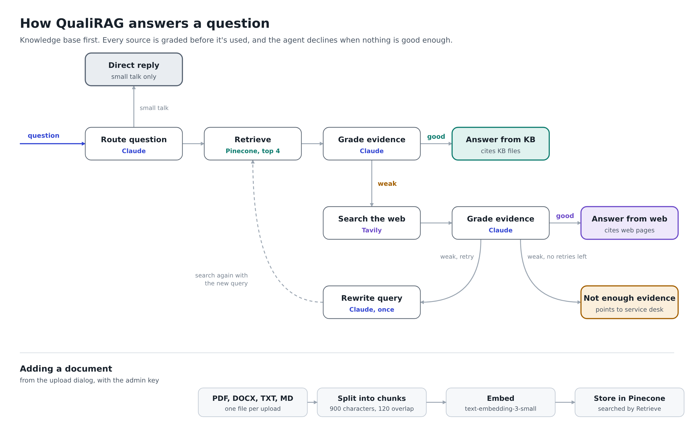

# QualiRAG

An IT support copilot that answers from a company knowledge base first, checks whether the evidence actually answers the question, and only then falls back to the web. When neither source is good enough, it says so and points to the service desk instead of guessing.

Built as a corrective RAG agent with LangGraph, Claude, Pinecone and FastAPI, on a synthetic knowledge base for a fictional retailer, Brightwick Retail Group.


**Live demo:** quali-rag.vercel.app

Try "How do I set up MFA on my new phone?" for a knowledge base answer, "How do I clear the Microsoft Teams cache on Windows 11?" for a web answer, and "What is the parental leave policy?" to see it decline. The panel on the right shows which path the agent took and why.

---

## The problem with plain RAG

A basic RAG pipeline retrieves the top few chunks and asks the model to answer from them, whatever they contain. That breaks in ways that matter for IT support:

- The closest chunks aren't always relevant, and the model answers anyway.
- Companies keep old policies around. A superseded password standard can still be the closest match.
- The same question has different answers for different people. Remote access works one way for employees, another for store staff and another for contractors.
- Some questions simply aren't covered, and a confident made-up answer is worse than "I don't know".

QualiRAG handles these by grading the evidence before it writes anything.

## How a question is answered



1. **Route.** Claude decides whether the message is an IT question or small talk. Small talk gets a direct reply with no retrieval.
2. **Retrieve.** The question is embedded and the 4 closest chunks are pulled from Pinecone.
3. **Grade the knowledge base evidence.** Claude marks it `good` only if the chunks contain the specific facts needed. It marks it `weak` if they're off-topic, only partly answer the question, come from a superseded document, or are meant for a different audience.
4. **Fall back to the web.** If the knowledge base is weak, Tavily searches the web and the results are graded the same way. Web results can't answer questions about Brightwick's own policies, so those grade `weak`.
5. **Rewrite and retry.** If both are weak, Claude rewrites the query with different keywords and expanded abbreviations, and the agent searches the knowledge base again. This happens once by default (`MAX_RETRIES=1`).
6. **Answer or stop.** A good grade leads to an answer that cites its sources: knowledge base file names or web links. If nothing grades good after the retry, the agent returns the service desk contact details instead of an answer.

Every step is recorded in a trace that comes back with the answer, so you can see why the agent did what it did.

## Features

- Evidence grading before every answer, with the option to decline
- Handles superseded policies and audience-specific documents in the knowledge base
- Web fallback with a separate grade, for general tech questions the knowledge base doesn't cover
- One automatic query rewrite and retry
- Citations to the source files or web pages
- Document upload from the UI (PDF, DOCX, TXT, Markdown), protected by an admin key
- A live view of the agent's path, its trace and its sources for each answer
- An audit log of every question, its answer source and its trace (SQLite)

## Tech stack

| Layer | Choice |
|---|---|
| Agent orchestration | LangGraph |
| LLM | Claude Haiku 4.5 (Anthropic) |
| Embeddings | OpenAI `text-embedding-3-small` (1536 dimensions), through an OpenAI-compatible gateway |
| Vector store | Pinecone serverless, cosine similarity |
| Web search | Tavily |
| API | FastAPI, Uvicorn |
| Frontend | Jinja template, plain HTML, CSS and JavaScript |
| Audit log | SQLite |
| Packaging | uv, Docker |
| Hosting | Vercel |

## The knowledge base

`data/knowledge_base/` holds 35 synthetic documents for Brightwick Retail Group: KB articles, policies, runbooks and SOPs, in Markdown, text, Word and PDF. The set is built to be hard on purpose:

- Two policies are marked superseded and contradict the current ones.
- Remote access works differently for employees, store staff and contractors, and headquarters printing is separate from store receipt printers, so similar questions need different documents.
- Some topics, like payroll or annual leave, are deliberately missing, to test whether the agent declines.

Every company, person and policy in it is fictional. `data/MANIFEST.md` lists each file and the traps built into the set.

## Project structure

```text
.
├── app/
│   ├── main.py                 # FastAPI app, static files, page route
│   ├── api/routes.py           # /api/health, /api/chat, /api/ingest
│   ├── core/
│   │   ├── config.py           # Settings, read from environment variables or .env
│   │   └── logging.py
│   ├── rag/
│   │   ├── workflow.py         # LangGraph nodes, routing and graph
│   │   ├── state.py            # Agent state and structured-output schemas
│   │   └── vector_store.py     # Embeddings, Pinecone index and retriever
│   └── services/
│       ├── data_ingestion.py   # File loaders and chunking
│       └── audit.py            # SQLite audit log
├── static/                     # app.js, style.css
├── templates/index.html
├── data/
│   ├── knowledge_base/         # The 35 synthetic documents
│   └── MANIFEST.md
├── ingest_kb.py                # Indexes the whole knowledge base folder
├── Dockerfile
├── pyproject.toml
└── uv.lock
```

## Running it locally

You need Python 3.14, [uv](https://docs.astral.sh/uv/), and API keys for Anthropic, Pinecone, Tavily and an OpenAI-compatible embeddings endpoint.

**1. Install dependencies**

```bash
uv sync
```

**2. Create a `.env` file in the project root**

```env
ANTHROPIC_API_KEY=...
OPENAI_API_KEY=...
PINECONE_API_KEY=...
TAVILY_API_KEY=...
ADMIN_API_KEY=choose-a-long-random-string
```

Optional settings and their defaults are in `app/core/config.py`. The ones you're most likely to change:

| Variable | What it does |
|---|---|
| `OPENAI_BASE_URL` | Embeddings endpoint. Set it to `https://api.openai.com/v1` to use OpenAI directly. |
| `EMBEDDING_MODEL` | Embedding model name. With OpenAI directly, use `text-embedding-3-small`. |
| `ANTHROPIC_MODEL` | Claude model. Defaults to Haiku 4.5. |
| `PINECONE_INDEX_NAME` | Index to use. It's created on first run if it doesn't exist. |
| `TOP_K` | Chunks retrieved per search (default 4) |
| `MAX_RETRIES` | Query rewrites before giving up (default 1) |

**3. Index the knowledge base (once)**

```bash
uv run python ingest_kb.py
```

This loads every file in `data/knowledge_base/`, splits it into 900-character chunks with 120 characters of overlap, embeds them and stores them in Pinecone. Chunk IDs are the file name plus the chunk's position, so running it again overwrites the vectors instead of duplicating them.

**4. Start the app**

```bash
uv run uvicorn app.main:app --reload
```

Open http://localhost:8000.

## Running with Docker

```bash
docker build -t qualirag .
docker run --rm -p 8000:8000 --env-file .env \
  -v qualirag_data:/app/data -v qualirag_uploads:/app/uploads qualirag
```

The image installs the exact versions from `uv.lock` and runs as a non-root user. The two volumes keep the audit log and uploaded files across restarts. Write your `.env` values without quotes, because Docker passes quotes through as part of the value.

## API

| Method | Path | Purpose |
|---|---|---|
| `GET` | `/api/health` | Returns `{"status": "ok", "service": ...}` |
| `POST` | `/api/chat` | Runs the agent on a question |
| `POST` | `/api/ingest` | Adds one document to the knowledge base. Needs the `X-Admin-Key` header. |

Ask a question:

```bash
curl -X POST http://localhost:8000/api/chat \
  -H "Content-Type: application/json" \
  -d '{"question": "How do I set up MFA on my new phone?"}'
```

The response contains `answer`, `source_used` (`private_kb`, `web_search`, `direct` or `insufficient_evidence`), `trace`, `citations` and `rewritten_query`.

Upload a document:

```bash
curl -X POST http://localhost:8000/api/ingest \
  -H "X-Admin-Key: your-admin-key" \
  -F "file=@voicemail_pin_reset.md"
```

The response contains `file`, `chunks` and `ids_created`.

## Deployment

The live demo runs on Vercel, which detects the FastAPI app in `app/main.py` and installs from `uv.lock`. Two things differ from running it locally:

- **Writable folders.** Vercel functions can only write to `/tmp`, so the deployment sets `AUDIT_DB_PATH=/tmp/audit.db` and `UPLOAD_DIR=/tmp/uploads`. Both reset when the function restarts. Uploaded documents stay searchable, because they live in Pinecone.
- **Upload batching.** Vectors are upserted to Pinecone without a thread pool (`async_req=False`), because Vercel's runtime doesn't provide the shared memory Python's thread pool needs.

## Known limitations

- Citations list every file that was retrieved, not only the ones the answer used.
- Each question is answered on its own. There's no conversation memory yet.
- The agent's steps appear after the answer finishes, not live.
- On Vercel, the audit log resets with the function, and uploads are capped at 4.5 MB per file.
- Upload takes one file at a time.
- There are no evaluation numbers yet, so answer quality hasn't been measured.

## What's next

- An evaluation harness with a labelled question set and RAGAS metrics (faithfulness, answer relevance, context precision), run in CI
- Citations limited to the passages the answer actually used
- Streaming the agent's steps to the UI as they happen

## License

See [LICENSE](LICENSE).
